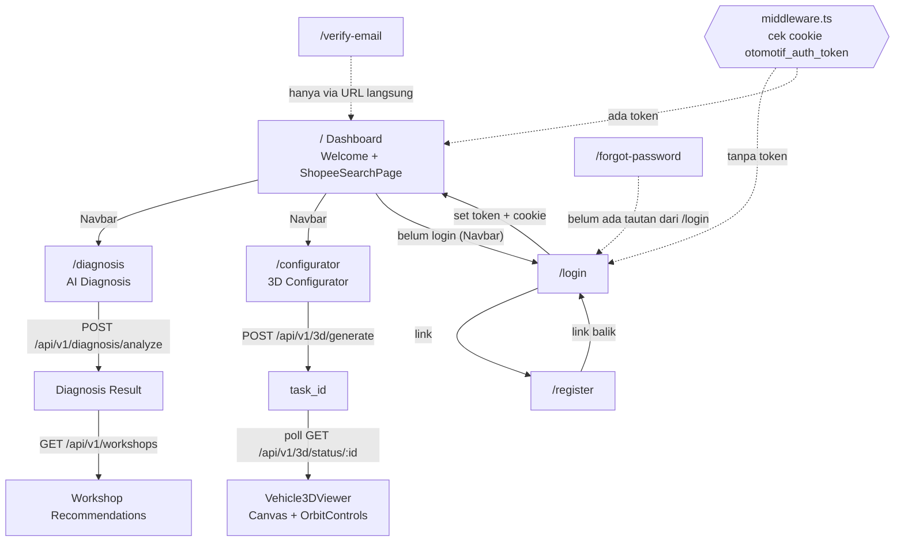

# Design System — Otomotif AI

Dokumen ini adalah **sumber kebenaran tunggal** untuk desain frontend yang sudah
terimplementasi di `frontend/`. Semua nilai di bawah dikutip dari kode nyata
(`frontend/tailwind.config.ts`, `frontend/app/globals.css`, dan komponen yang
disebut di setiap bagian), bukan dari mockup Figma yang belum dibuat.

Menggantikan deliverable Issue #14 (Figma Design File): alih-alih file Figma
terpisah yang bisa *drift* dari implementasi, token dan komponen didefinisikan di
CSS variables + Tailwind, sehingga kode dan desain selalu sinkron.

| Sumber | File |
|---|---|
| Token warna & font (Tailwind) | `frontend/tailwind.config.ts` |
| Token runtime (CSS variables) | `frontend/app/globals.css` |
| Kelas komponen global | `frontend/app/globals.css` (`@layer components`) |
| Layout root (navbar + footer) | `frontend/app/layout.tsx` |
| Spesifikasi UI/UX asli | `docs/ui-ux/UI_UX_Design_Specification.md` |

---

## 1. Palet Warna

Warna didefinisikan dua kali dengan sengaja: sebagai Tailwind token (untuk
`bg-primary`, `text-muted`, dst.) dan sebagai CSS variable di `:root` (untuk
dipakai lewat arbitrary value `bg-[var(--accent)]` yang otomatis ikut berubah
kalau tema diganti). **Komponen memakai CSS variable**, bukan kelas warna
Tailwind, supaya satu perubahan di `:root` mengubah seluruh aplikasi.

| Peran | CSS variable | Tailwind token | Hex | Pemakaian |
|---|---|---|---|---|
| Teks utama | `--foreground` | `primary` | `#1F2937` | heading, body default |
| Latar halaman | `--background` | — | `#F9FAFB` | `body` |
| Permukaan kartu | `--card` | — | `#FFFFFF` | `.card`, navbar, footer |
| Aksen / aksi utama | `--accent` | `accent` | `#10B981` | `.btn-primary`, link hover, logo mark |
| Aksi sekunder / info | — | `secondary` | `#3B82F6` | warna mobil default 3D, tautan info |
| Teks sekunder | `--muted-foreground` | `muted` | `#6B7280` | label bantuan, meta, footer link |
| Garis / pemisah | `--border` | `border` | `#E5E7EB` | border kartu, `border-b` navbar, `border-t` footer |
| Bahaya (di luar token) | — | — | `red-500` | tombol "Keluar" di Navbar |

Aturan pakai:

- Hijau (`accent`) hanya untuk **satu** aksi utama per layar. Di Auth form itu
  tombol submit; di Navbar itu indikator brand, bukan tombol.
- Biru (`secondary`) bukan warna aksi—dipakai untuk penanda visual (material 3D
  default `#3b82f6` di `Vehicle3DViewer`).
- Tidak ada mode gelap. `body` punya `transition-colors` dan semua warna lewat
  variable, jadi menambah dark mode cukup menimpa `:root` di dalam
  `@media (prefers-color-scheme: dark)` tanpa menyentuh komponen.

## 2. Tipografi

Font stack sistem, tanpa webfont eksternal (nol request tambahan, tidak ada
FOUT):

```
--font-sans: -apple-system, BlinkMacSystemFont, 'Segoe UI', 'Roboto', 'Oxygen',
  'Ubuntu', 'Cantarell', 'Fira Sans', 'Droid Sans', 'Helvetica Neue', sans-serif;
```

Diekspos ke Tailwind sebagai `fontFamily.sans: ['var(--font-sans)', 'system-ui', 'sans-serif']`
dan dipakai otomatis oleh `body` (`font-sans`).

Skala yang benar-benar dipakai di halaman:

| Peran | Kelas | Contoh |
|---|---|---|
| Judul halaman | `text-4xl font-bold` | `Welcome to Otomotif AI` (`app/page.tsx`) |
| Judul halaman sekunder | `text-3xl font-bold` | `AI Diagnosis` (`app/diagnosis/page.tsx`) |
| Judul seksi | `text-xl font-bold` | `Diagnosis Result`, `Workshop Recommendations` |
| Judul kartu / hasil | `text-lg font-bold` | nama produk Shopee, brand Navbar |
| Body / kontrol | `text-sm font-medium` | link Navbar, label form, tombol |
| Teks bantuan | `text-sm text-[var(--muted-foreground)]` | deskripsi, email user, footer |

Bobot yang dipakai hanya dua: `font-medium` (kontrol & label) dan `font-bold`
(judul). Tidak ada `font-light`/`font-black`—menambah satu bobot tanpa alasan
membuat hierarki kabur.

## 3. Komponen

### 3.1 Kelas global (`globals.css`)

Didefinisikan di `@layer components`, dipakai lintas halaman:

| Kelas | Definisi | Kapan dipakai |
|---|---|---|
| `.container-app` | `max-w-7xl mx-auto px-4` | satu-satunya pembungkus lebar konten; dipakai `layout.tsx`, Navbar, Footer |
| `.btn` | `inline-flex items-center justify-center px-4 py-2 rounded-lg font-medium transition-colors` | basis semua tombol |
| `.btn-primary` | `bg-[var(--accent)] text-white hover:bg-green-600` | aksi utama (submit form) |
| `.btn-secondary` | `bg-[var(--card)] border border-[var(--border)] hover:bg-gray-50` | aksi alternatif / batal |
| `.card` | `bg-[var(--card)] border border-[var(--border)] rounded-lg p-4 shadow-sm` | setiap panel: form, hasil diagnosis, produk |

Radius konsisten `rounded-lg`; `shadow-sm` satu-satunya elevasi. Tidak ada
`shadow-md`/`xl`—kartu dipisahkan oleh border, bukan bayangan.

### 3.2 Navbar — `frontend/app/components/Navbar.tsx`

- `sticky top-0 z-50`, tinggi tetap `h-16`, latar `var(--card)` + `border-b`.
- Kiri: logo mark `w-8 h-8 rounded-lg bg-[var(--accent)]` + teks brand
  `font-bold text-lg` ("Otomotif AI").
- Tengah: tiga tautan utama — **Dashboard** (`/`), **Diagnosis** (`/diagnosis`),
  **3D Config** (`/configurator`); `text-sm font-medium`, hover jadi `accent`.
- Kanan, dua state dari `useAuthStore`:
  - terautentikasi → email user (`text-sm text-[var(--muted-foreground)]`) +
    tombol **Keluar** (`text-red-500 hover:underline`, memanggil `logout()` lalu
    `router.push('/login')`);
  - belum → tautan **Masuk** (`/login`) dan **Daftar** (`/register`).
- Tidak ada menu mobile/hamburger—`flex gap-8` menyusut di layar kecil. Ini
  batasan yang diketahui (lihat §6).

### 3.3 Footer — `frontend/app/components/Footer.tsx`

- `border-t`, latar `var(--card)`, `mt-16`, di dalam `.container-app`.
- Grid 4 kolom: **Product** (AI Diagnosis, 3D Configurator, Workshop Finder),
  **Company**, **Resources**, **Legal**; judul `font-bold mb-4`, item
  `space-y-2 text-sm`.
- Baris bawah: copyright `© 2026 Otomotif AI` + tautan sosial.
- Semua tautan masih `href="#"`—placeholder navigasi, bukan halaman nyata.

### 3.4 Form input (Auth & Diagnosis)

Pola identik di `login`, `register`, `forgot-password`, `diagnosis`:

```tsx
<label className="block text-sm font-medium mb-1">Email</label>
<input type="email" className="w-full px-3 py-2 border border-[var(--border)] rounded-lg ..." />
```

- Label selalu di atas input (`block`), tidak pernah placeholder-only.
- Input: `px-3 py-2`, `rounded-lg`, border `var(--border)`.
- Error dari store ditampilkan inline; tombol submit `type="submit"` dengan
  `.btn` + `.btn-primary`.

### 3.5 Auth (`/login`, `/register`, `/forgot-password`, `/verify-email`)

- Satu kartu `.card` terpusat per halaman, judul `text-3xl font-bold`.
- Field: Login = Email + Kata Sandi; Register = Nama Lengkap + Email + Kata Sandi;
  Forgot = Email; Verify = status verifikasi + tombol kirim ulang.
- State auth di `frontend/app/store/auth.ts` (Zustand + `persist`):
  `user`, `tokens`, `isAuthenticated`, `isLoading`, `error`; aksi `login`,
  `register`, `refresh`, `logout`, `clearError`.
- Token ganda: `localStorage` (key `auth-storage`) untuk komponen, dan cookie
  `otomotif_auth_token` (path `/`, `max-age=604800`, `SameSite=Lax`) untuk
  `middleware.ts`—middleware tidak bisa membaca `localStorage`.
- `middleware.ts`: path publik `['/', '/login', '/register', '/forgot-password',
  '/verify-email']`; tanpa cookie → redirect ke `/login?callbackUrl=<path>`;
  sudah login tapi membuka halaman auth → redirect `/`.

### 3.6 Vehicle3DViewer — `frontend/app/components/Vehicle3DViewer.tsx`

- Props `{ taskId }`; mengambil mesh lewat polling `GET /api/v1/3d/status/{taskId}`
  sampai `mesh_url` tersedia.
- Canvas `@react-three/fiber` tinggi `h-80 w-full` dengan `shadows`,
  `OrbitControls` (`enableZoom`, `enablePan={false}` — pan dimatikan supaya model
  tidak bisa hilang dari viewport).
- Material di-*traverse* dan `material.color.set(color)` dipanggil di `useEffect`
  setiap warna berubah → pewarnaan tanpa reload mesh.
- Kontrol warna `<input type="color" />` default `#3b82f6` (`secondary`).
- Loading state teks; error state teks; tidak ada spinner grafis.

### 3.7 Configurator (`/configurator`)

- Grid pilihan part dari `useConfiguratorStore`: **Wheels**, **Exhaust**,
  **Suspension**, **Body Kit**, masing-masing 3 opsi (Stock / menengah / performa).
- `togglePart(category, partId)` bersifat toggle-per-kategori (pilih opsi lain
  menggantikan, klik opsi yang sama mengosongkan), `clearParts()` mereset semua.
- Tombol generate → `POST /api/v1/3d/generate` (multipart: `vehicle_brand`,
  `vehicle_model`, 4 file `images`) → `task_id` → diteruskan ke `Vehicle3DViewer`.

### 3.8 Diagnosis (`/diagnosis`)

- Input: `textarea` gejala bebas (Bahasa Indonesia) + info kendaraan dari
  `useDiagnosisStore` (`vehicleMake`, `vehicleModel`, `vehicleYear`).
- Submit → `POST /api/v1/diagnosis/analyze`; hasil dirender di kartu
  **Diagnosis Result** (`text-xl font-bold`) dan **Workshop Recommendations** yang
  diambil dari `GET /api/v1/workshops`.
- Semua panggilan HTTP lewat `frontend/app/lib/api.ts` (`apiRequest`), yang
  memakai `NEXT_PUBLIC_API_URL` sebagai basis—bukan path relatif, karena tidak ada
  `rewrites` di `next.config.js` sehingga `/api/...` akan mengenai origin Next.js
  sendiri dan 404.
- Tiga state wajib ada dan sudah ada: loading (tombol disabled), error (pesan
  inline), hasil kosong (kartu tidak dirender).

### 3.9 ShopeeSearch — `frontend/app/components/ShopeeSearch.tsx` + `ShopeeSearchPage.tsx`

- Kotak pencarian (input + `.btn-primary`) di halaman Dashboard.
- Hasil: daftar kartu `.card` dengan `h3 font-bold` nama produk, `h2 text-lg
  font-bold` untuk judul seksi "Hasil pencarian".
- Sumber data: `POST /shopee/search` (backend meneruskan ke Shopee Affiliate API
  dengan UTM affiliate).

## 4. Alur Halaman



Layout setiap halaman: `Navbar` → `<main className="flex-1 container-app py-8">`
→ `Footer`, dari `app/layout.tsx`. Metadata root: title `Otomotif AI - Vehicle
Diagnosis & Configurator`.

| Route | File | Fungsi |
|---|---|---|
| `/` | `app/page.tsx` | Dashboard: sapaan + pencarian produk Shopee |
| `/diagnosis` | `app/diagnosis/page.tsx` | Analisis gejala + rekomendasi bengkel |
| `/configurator` | `app/configurator/page.tsx` | Pemilihan part + viewer 3D |
| `/login` | `app/login/page.tsx` | Form masuk |
| `/register` | `app/register/page.tsx` | Form daftar |
| `/forgot-password` | `app/forgot-password/page.tsx` | Minta reset kata sandi |
| `/verify-email` | `app/verify-email/page.tsx` | Status verifikasi email |

## 5. State Management

Zustand tanpa boilerplate Redux. Tiga store:

| Store | File | Isi |
|---|---|---|
| `useAuthStore` | `app/store/auth.ts` | user, tokens, `isAuthenticated`, `isLoading`, `error`; `login`/`register`/`refresh`/`logout`; `persist` ke localStorage + sinkron cookie |
| `useDiagnosisStore` | `app/store.ts` | `symptomText`, `vehicleMake/Model/Year`, `setSymptomsText`, `setVehicleInfo`, `reset` |
| `useConfiguratorStore` | `app/store.ts` | `selectedParts`, `togglePart`, `clearParts` |

Pemisahan store per-domain (bukan satu store global) supaya perubahan state
configurator tidak me-render ulang halaman diagnosis.

## 6. Batasan yang Diketahui

Dicatat jujur supaya tidak dianggap "sudah selesai sempurna":

- **Belum ada file Figma.** Issue #14 ditutup dengan dokumen ini sebagai gantinya.
  Konsekuensinya tidak ada prototype interaktif atau aset handoff untuk desainer.
- **Navigasi belum responsif.** Navbar memakai `flex gap-8` tanpa menu mobile;
  di bawah ~640px tautan akan berdesakan.
- **Belum ada dark mode**, walau seluruh warna sudah lewat CSS variable sehingga
  penambahannya murah.
- **Tautan Footer masih placeholder** (`href="#"`).
- **Tidak ada komponen sidebar.** Issue #4 menyebut sidebar; layout yang
  terimplementasi memakai navbar atas + konten selebar `max-w-7xl`, tanpa sidebar.
- **Belum ada ikonografi.** Logo adalah blok warna `rounded-lg`, tidak ada icon set.
- **Aksesibilitas belum diaudit.** `html lang="en"` sementara konten berbahasa
  Indonesia; kontras `accent #10B981` di atas putih ≈ 2.5:1 sehingga tidak lolos
  WCAG AA untuk teks normal—aman untuk elemen besar/tombol dengan teks putih,
  tidak aman untuk teks kecil berwarna accent di atas latar terang.
- **`@react-three/fiber`, `@react-three/drei`, `three`, dan `zustand` ada di
  `devDependencies`**, padahal dipakai di runtime. `npm ci` (Docker) aman karena
  memasang dev deps, tapi `npm ci --omit=dev` akan mematahkan build.
- **`npm test` masih placeholder** (`exit 1`); tidak ada test frontend.
- **Next.js 16.4.3 memblokir `next build` sekali** dengan `SecurityFatalError`
  (advisory keamanan) lalu lanjut pada percobaan kedua. Perlu upgrade.
  `middleware.ts` juga sudah memunculkan peringatan deprecation
  `middleware-to-proxy`.
